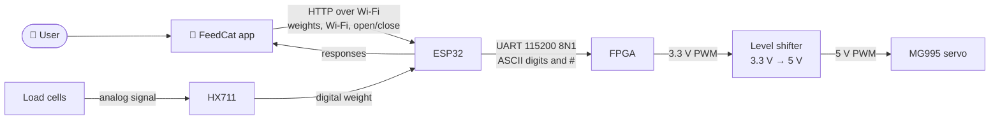

# FeedCat 🐱

**English** | [Português (BR)](README.pt-BR.md)

A smart feeder that gives food only to the right cat, identified by its **weight**.

Final project for **PCS3645 – Digital Laboratory II** at the Polytechnic School of the University of São Paulo (Escola Politécnica da USP), 2024. Class 5, bench A5.

## The problem

In homes with more than one cat, an overweight cat often eats the food meant for a cat on a diet, or for one that needs to gain weight. FeedCat solves this with a scale in front of the food compartment. When an animal steps on the scale, the system compares its weight with a configured range (minimum and maximum weight). If the weight is inside the range, a servo motor opens the compartment. Otherwise, the compartment stays closed.

## Architecture



| Component | Role |
|---|---|
| **FPGA (Intel/Altera, Quartus)** | Main logic in Verilog: receives the weights over serial, compares them with the range and drives the servo with PWM |
| **4 × 50 kg load cells + HX711** | Measure the weight of whoever is on the scale |
| **ESP32** | Bridge between the app and the FPGA: hosts a Wi-Fi network, exposes an HTTP API and forwards the data to the FPGA over UART |
| **MG995 servo** | Opens and closes the food compartment |
| **FeedCat app (Expo / React Native)** | Sets up the ESP32 Wi-Fi, sets the minimum and maximum weight, and opens or closes the compartment manually |

> The ESP32 firmware is not included in this repository.

## Digital circuit (FPGA)

The code is in [`hardware/Verilog`](hardware/Verilog). It is split into a datapath (*fluxo de dados*, FD) and control units (*unidades de controle*, UC). File and signal names are in Portuguese.

| File | Description |
|---|---|
| `circuito.v` | Top-level module: connects the datapath, both control units and the six 7-segment displays |
| `circuito_fd.v` | Datapath: serial receiver, shift register for the weights, comparators, servo position counter and PWM generator |
| `circuito_uc.v` | Reception control unit: stores the received digits and toggles "manual open" mode when the `#` command arrives |
| `comporta_uc.v` | Gate control unit: opens the servo gradually, waits while the opening condition is still true, then closes it |
| `servo/` | `controle_servo_3`, `circuito_pwm` (8 positions, 20 ms period) and `contador_updown` (counts 0 to 7 and back to 0) |
| `serial/rx_serial_8n1_nandland.v` | UART receiver, 434 clock cycles per bit (115200 baud with a 50 MHz clock) |
| `modulos/` | Basic building blocks: `comparador_n`, `registrador_n`, `contador_m`, `mux_8x1_n`, `hexa7seg` |
| `circuito_tb.v` | Testbench: sends bytes over serial using `tx_serial_8N1_nandland` |

### Serial protocol

Every byte is an ASCII character, sent at 115200 baud in 8N1 format.

- **Digits `0`–`9`** go into a shift register. The FPGA expects 6 digits in this order: maximum weight (2 digits), minimum weight (2 digits) and current weight (2 digits). Each value is in units of 0.1 kg, so `15` means 1.5 kg. Because it is a shift register, all 6 digits must be sent on every update.
- **`#`** toggles manual open/close, for example to refill the compartment.

For example, the sequence `302015` sets the maximum to 3.0 kg, the minimum to 2.0 kg and the current weight to 1.5 kg. The current weight is outside the range, so the compartment stays closed.

### How it works

1. The gate control unit starts opening the servo when `min_weight ≤ current_weight ≤ max_weight`, when the `abrir` button is pressed, or when manual mode (`#`) is on. Except in manual mode, a maximum weight must have been configured (`max_weight ≠ 0`).
2. The servo steps through positions 0 → 7, 20 ms apart, so it opens smoothly.
3. It stays open while the condition remains true, that is, while the cat is on the scale or manual mode is on.
4. Then it steps back from 7 → 0 and closes the compartment.

### Board I/O and debugging

| Signal | Description |
|---|---|
| `abrir` | Push button to open manually |
| `select_ucs` | Switch that chooses what the displays show |
| `HEX5..HEX0` | With `select_ucs = 0`: max weight, min weight and current weight. With `select_ucs = 1`: servo position, reception control unit state and gate control unit state |
| `abrir_db`, `comando_db`, `db_pertence_ao_intervalo`, `db_abrir_comporta` | Debug LEDs: open button, `#` command received, weight in range, gate opening |

### Simulation

Use [Icarus Verilog](https://steveicarus.github.io/iverilog/) and [GTKWave](https://gtkwave.sourceforge.net/):

```bash
cd hardware/Verilog
python3 comp.py             # writes comp.txt listing every non-testbench .v file
echo circuito_tb.v >> comp.txt
iverilog -o circuito.out -c comp.txt
vvp circuito.out            # writes wave.vcd
gtkwave wave.vcd a.gtkw
```

> - The `comp.txt` in the repository was generated on Windows and uses `\` in its paths. On Linux or macOS, run `comp.py` again before compiling.
> - The testbench waits an extremely long time before `$finish`, so the simulation does not end by itself and `wave.vcd` keeps growing. Stop `vvp` with Ctrl+C once the cases you want have run, or reduce that delay in `circuito_tb.v`.

### Synthesis

The Quartus project is archived in `hardware/Quartus/circuito.qar`. To open it, use **Quartus Prime → Project → Restore Archived Project**.

## Mobile app

The code is in [`app/`](app) and uses Expo SDK 51 with expo-router. The interface is in Portuguese.

Screens:
- **Home** (`app/(tabs)/index.tsx`): form for the minimum and maximum weight (0.5 to 9.9 kg), form for the Wi-Fi SSID and password, and a button to open or close the door.
- **Informações** (`app/(tabs)/explore.tsx`): user guide.

The app talks to the ESP32 over HTTP. The default IP is `192.168.4.1`, which belongs to the "Feed Cat" access point:

| Method | Route | Body |
|---|---|---|
| `POST` | `/receive-wifi` | `{ wifiSsid, wifiPassword }`, response `{ status: "connected", ip }` |
| `POST` | `/send-scale-data` | `{ minimumWeight, maximumWeight }` in grams |
| `POST` | `/open-door` | `{ doorStatus }` |

To run it:

```bash
cd app
npm install
npx expo start
```

## Repository layout

```
docs/       specification (PDF, in Portuguese), original architecture diagram and pseudocode
hardware/
├── Verilog/   final circuit and testbench
└── Quartus/   archived project (.qar)
app/        mobile app (Expo)
```

## Versions

Each week of the project is a tagged version of the repository:

| Tag | Week | Contents |
|---|---|---|
| [`v0`](https://github.com/jofe2003/feedcat/tree/v0) | 0 | Specification, architecture and pseudocode |
| [`v1`](https://github.com/jofe2003/feedcat/tree/v1) | 1 | Prototype: ESP32 → FPGA serial reception, showing the digit on a display |
| [`v3`](https://github.com/jofe2003/feedcat/tree/v3) | 3 | Final version: weight comparison, servo control and mobile app |

## Team

- Felipe Luis Korbes
- João Felipe de Souza Melo
- João Felipe Pereira Carvalho

Advisor: Prof. Reginaldo Arakaki

## License

Distributed under the MIT License. See [LICENSE](LICENSE).
