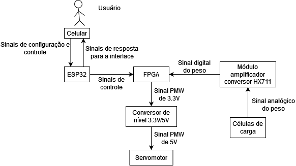

# FeedCat 🐱

> **Versão v0 (semana 0): especificação.** Esta versão tem só a proposta do projeto. As versões seguintes estão nas [tags/releases](../../tags).

Alimentador inteligente que só libera a comida para o gato certo, identificado pelo **peso**.

Projeto final da disciplina **PCS3645 – Laboratório Digital II** (Escola Politécnica da USP, 2024).

## Proposta

Em casas com mais de um gato, o gato acima do peso costuma comer a ração do outro. O FeedCat coloca uma balança na frente do compartimento de comida. Quando o peso de quem está na balança fica dentro de uma faixa configurável (peso mínimo e máximo), um servo motor abre o compartimento.

### Hardware previsto

- Placa FPGA, onde fica toda a lógica de controle
- 4 células de carga de 50 kg e o módulo amplificador HX711
- Servo motor MG995
- ESP32, para configurar os pesos e abrir o compartimento pelo celular
- Conversor de nível

## Conteúdo

| Arquivo | Descrição |
|---|---|
| `docs/especificacao.pdf` | Especificação preliminar: objetivos, montagem física, requisitos e cronograma |
| `docs/arquitetura-estrutural.png` | Diagrama da arquitetura |
| `docs/pseudo-codigo.py` | Pseudocódigo da lógica de abertura |

## Equipe

- Felipe Luis Korbes
- João Felipe de Souza Melo
- João Felipe Pereira Carvalho
