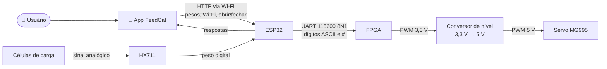

# FeedCat 🐱

[English](README.md) | **Português (BR)**

Alimentador inteligente que só libera a comida para o gato certo, identificado pelo **peso**.

Projeto final da disciplina **PCS3645 – Laboratório Digital II** (Escola Politécnica da USP, 2024), Turma 5, Bancada A5.

## O problema

Em casas com mais de um gato, é comum que um gato acima do peso coma a ração de outro que está em dieta ou precisa ganhar peso. O FeedCat resolve isso com uma balança na frente do compartimento de comida: quando um animal sobe na balança, o sistema compara o peso medido com uma faixa configurada (peso mínimo e máximo). Se o peso estiver dentro da faixa, um servo motor abre o compartimento. Caso contrário, o compartimento continua fechado.

## Arquitetura



| Componente | Função |
|---|---|
| **FPGA (Intel/Altera, Quartus)** | Lógica principal em Verilog: recebe os pesos pela serial, compara com a faixa e controla o servo por PWM |
| **4 células de carga 50 kg + HX711** | Medem o peso de quem está na balança |
| **ESP32** | Ponte entre o app e a FPGA: cria uma rede Wi-Fi, expõe uma API HTTP e envia os dados para a FPGA via UART |
| **Servo MG995** | Abre e fecha o compartimento de comida |
| **App FeedCat (Expo / React Native)** | Configura o Wi-Fi do ESP32, define os pesos mínimo e máximo e abre ou fecha o compartimento manualmente |

> O firmware do ESP32 não está neste repositório.

## Circuito digital (FPGA)

Código em [`hardware/Verilog`](hardware/Verilog), dividido em fluxo de dados e unidades de controle:

| Arquivo | Descrição |
|---|---|
| `circuito.v` | Módulo topo: liga FD, as duas UCs e os 6 displays de 7 segmentos |
| `circuito_fd.v` | Fluxo de dados: receptor serial, registrador de deslocamento dos pesos, comparadores, contador de posição do servo e gerador de PWM |
| `circuito_uc.v` | UC de recepção: guarda os dígitos recebidos e alterna o modo "abrir manualmente" quando chega o comando `#` |
| `comporta_uc.v` | UC da comporta: abre o servo gradualmente, espera enquanto a condição de abertura continuar ativa e depois fecha |
| `servo/` | `controle_servo_3`, `circuito_pwm` (8 posições, período de 20 ms) e `contador_updown` (sobe de 0 a 7 e volta a 0) |
| `serial/rx_serial_8n1_nandland.v` | Receptor UART, com 434 ciclos por bit (115200 baud com clock de 50 MHz) |
| `modulos/` | Componentes básicos: `comparador_n`, `registrador_n`, `contador_m`, `mux_8x1_n`, `hexa7seg` |
| `circuito_tb.v` | Testbench: envia bytes pela serial usando `tx_serial_8N1_nandland` |

### Protocolo serial

Todos os bytes são caracteres ASCII, a 115200 baud, no formato 8N1.

- **Dígitos `0`–`9`**: entram num registrador de deslocamento. A FPGA espera 6 dígitos, nesta ordem: peso máximo (2 dígitos), peso mínimo (2 dígitos) e peso atual (2 dígitos). Cada valor usa unidades de 0,1 kg, então `15` significa 1,5 kg. Como é um registrador de deslocamento, os 6 dígitos precisam ser enviados em toda atualização.
- **`#`**: comando para abrir ou fechar o compartimento manualmente, por exemplo para reabastecer.

Por exemplo, a sequência `302015` define máximo de 3,0 kg, mínimo de 2,0 kg e peso atual de 1,5 kg. Como o peso atual está fora da faixa, o compartimento continua fechado.

### Funcionamento

1. A UC da comporta começa a abrir o servo quando `peso_min ≤ peso_atual ≤ peso_max`, quando o botão `abrir` é pressionado ou quando o modo manual (`#`) está ativo. Fora do modo manual, é preciso ter um peso máximo configurado (`peso_max ≠ 0`).
2. O servo passa pelas posições 0 → 7 com intervalo de 20 ms entre elas, para abrir suavemente.
3. O servo fica aberto enquanto a condição continuar verdadeira, ou seja, enquanto o gato estiver na balança ou o modo manual estiver ativo.
4. Depois disso, o servo volta de 7 → 0 e fecha o compartimento.

### Pinos e depuração na placa

| Sinal | Descrição |
|---|---|
| `abrir` | Botão para abrir manualmente |
| `select_ucs` | Chave que escolhe o que aparece nos displays |
| `HEX5..HEX0` | Com `select_ucs = 0`: peso máx., peso mín. e peso atual. Com `select_ucs = 1`: posição do servo, estado da UC de recepção e estado da UC da comporta |
| `abrir_db`, `comando_db`, `db_pertence_ao_intervalo`, `db_abrir_comporta` | LEDs de depuração: botão de abrir, comando `#` recebido, peso dentro da faixa e comporta abrindo |

### Simulação

Use [Icarus Verilog](https://steveicarus.github.io/iverilog/) e [GTKWave](https://gtkwave.sourceforge.net/):

```bash
cd hardware/Verilog
python3 comp.py             # gera comp.txt com todos os .v que não são testbench
echo circuito_tb.v >> comp.txt
iverilog -o circuito.out -c comp.txt
vvp circuito.out            # gera wave.vcd
gtkwave wave.vcd a.gtkw
```

> - O `comp.txt` versionado foi gerado no Windows e usa `\` nos caminhos. No Linux/macOS, rode `comp.py` de novo antes de compilar.
> - O testbench espera um tempo enorme antes do `$finish`, então a simulação não termina sozinha e o `wave.vcd` continua crescendo. Interrompa o `vvp` com Ctrl+C depois dos casos que você quer ver, ou diminua esse atraso no `circuito_tb.v`.

### Síntese

O projeto do Quartus está arquivado em `hardware/Quartus/circuito.qar`. Para abrir, use **Quartus Prime → Project → Restore Archived Project**.

## Aplicativo

O código fica em [`app/`](app) e usa Expo SDK 51 com expo-router.

Telas:
- **Home** (`app/(tabs)/index.tsx`): formulário para os pesos mínimo e máximo (de 0,5 a 9,9 kg), formulário com o SSID e a senha do Wi-Fi e botão para abrir ou fechar a porta.
- **Informações** (`app/(tabs)/explore.tsx`): manual de uso.

O app se comunica com o ESP32 por HTTP. O IP padrão é `192.168.4.1`, o do access point "Feed Cat":

| Método | Rota | Corpo |
|---|---|---|
| `POST` | `/receive-wifi` | `{ wifiSsid, wifiPassword }` e resposta `{ status: "connected", ip }` |
| `POST` | `/send-scale-data` | `{ minimumWeight, maximumWeight }` em gramas |
| `POST` | `/open-door` | `{ doorStatus }` |

Para rodar:

```bash
cd app
npm install
npx expo start
```

## Estrutura do repositório

```
docs/       especificação (PDF), diagrama de arquitetura original e pseudocódigo
hardware/
├── Verilog/   circuito final e testbench
└── Quartus/   projeto arquivado (.qar)
app/        aplicativo mobile (Expo)
```

## Versões

Cada semana do projeto virou uma versão (tag) do repositório:

| Tag | Semana | Conteúdo |
|---|---|---|
| [`v0`](https://github.com/jofe2003/feedcat/tree/v0) | 0 | Especificação, arquitetura e pseudocódigo |
| [`v1`](https://github.com/jofe2003/feedcat/tree/v1) | 1 | Protótipo: recepção serial ESP32 → FPGA mostrando o dígito no display |
| [`v3`](https://github.com/jofe2003/feedcat/tree/v3) | 3 | Versão final: comparação de pesos, controle do servo e aplicativo |

## Equipe

- Felipe Luis Korbes
- João Felipe de Souza Melo
- João Felipe Pereira Carvalho

Orientador: Prof. Reginaldo Arakaki

## Licença

Distribuído sob a licença MIT. Veja [LICENSE](LICENSE).
